# Open source demand control ventilation system #
## Introduction
This project is intended as a replacement of the Itho Demandflow controller. The reason that this project was started because my controller at home was behaving strange, the transformer and fuse failed and it is expensive to replace. With modern microcontrollers it should be relatively easy to make a controller for such a system. This project is inspired by the orignal Itho controller but not an exact copy of the Itho controller. Compared to the Itho controller, this design provides full transparancy on what it exactly does. 

The basis for this design is:
* Speed of Itho fan can be controlled by either MQTT or HTTP API with settings Low, Medium and High. To set the fanspeed of an Itho fan See https://www.nrgwatch.nl/
* The controller has 12 channels for 12 Itho valves of type DemandFlow Klep (545-7100). No changes required to the default connection on the valve.
* This controller can be a 1:1 replacement
* The system must be modular, e.g. it is not required to add the display, a different I2C RTC could be used, the number, type and location of sensors can be adjusted in the application
* The software is open source
* The hardware is open source
* The hardware can be used as an ESP32-S3 development platform to experiment with sensors, displays, other i2C devices and connectivity (wifi and ethernet)

Two hardware revisions are available (there has never been a revision 3):

### Revision 2

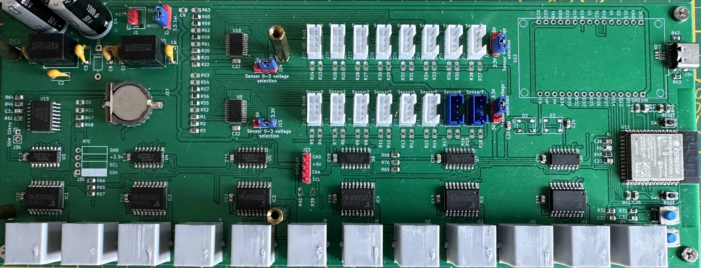

### Revision 4

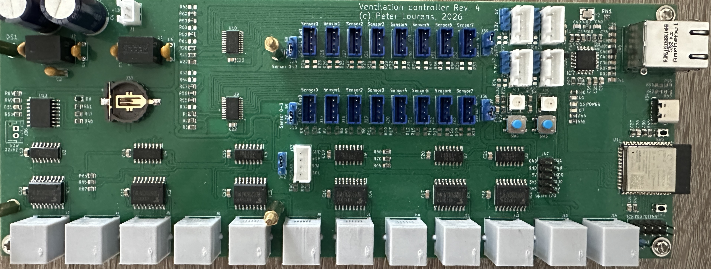

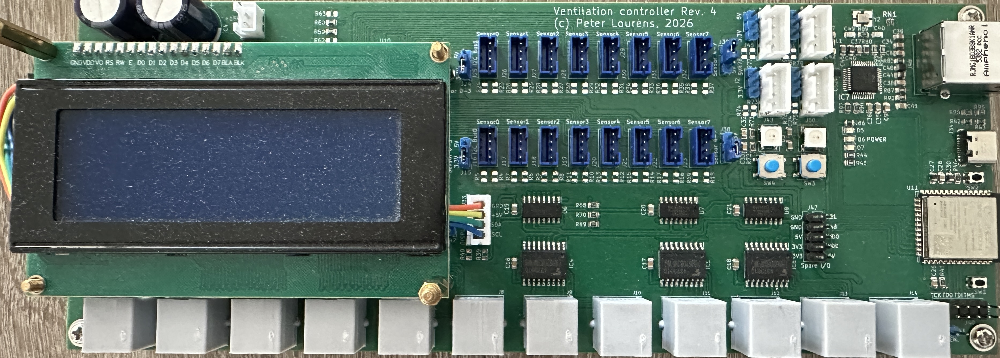

The essential difference between both version is the removal of the external interface for an ESP32 module, the addition of a W5500 ethernet interface and 2 additional status LEDs, per default used to indicate wifi and ethernet status.

Documentation of the software has been automatically generated (by AI and )

## Hardware design
The hardware design is based on commonly available electronic parts. The basis of the design:
* Microcontroller ESP32-S3.
* 74HC595 for multiplication of processor I/O. Each valve has 4 coils to control and therefore 4 outputs are required per valve. In total 48 outputs are required. The 74HC595 are divided in two groups enabling scaling down to 6 valves for smaller houses (not yet implemented in software).
* Use of two I2C busses:
    * Bus 0 with connectors for 8 sensors and LCD (4x20 characters with I2C backpack) and 2 spare I2C connectors (rev4 only)
    * Bus1 with connectors for 8 sensors and Realtime Clock DS3231 and 2 spare I2C connectors (rev4 only)
* Commonly used sensors; DHT20, SCD40/41. Other sensors can be integrated as well as long as they use the I2C bus
* All I2C connections can have pull-up resistors if not integrated in the connected devices
* Connection to sensors through I2C multiplexer (TCA9548) enabling the use of I2C sensors with fixed I2C addresses
* 2 Addressable RGB LEDs for status and fandspeed
* 2 Configurable pushbuttons, one is standard allocated to turn on the LCD
* A red power LED
* A green LED (rev4 only default assigned to WIFI status)
* A blue LED (rev4 only default assigned to Ethernet status)
* Accurate RTC with rechargeable battery backup because most actions are time based, alternative can be connected to spare I2C connectors 
* Single 15V power supply with on-board (non-isolating) 3.3V and 5V convertors (1A capacity each)
* Operation of sensors on 5V or 3.3V. Data communication always on 3.3V
* MOSFET output drivers for low on state resistance. Alternatively ULN2803 could used as well (pin compatible)

### Valve control design
The valves are stepper motors with 4 windings and two windings have a common connection. The stepper motor made by Saia of type UCD2EZ7. The common connection is connected to +15V and the 4 other winding connections are connected with a MOSFET. By turning on the MOSFET, the windings can be individually energised. The winding voltage is 12V and taking a voltage drop over de MOSFET into account, 15V is an appropriate voltage. The circuit of one valve is outlined below. 

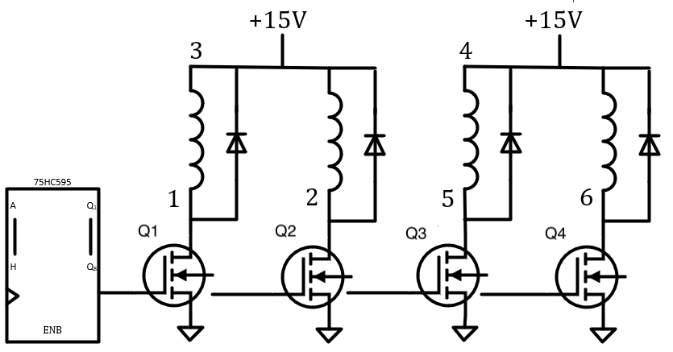

Pin 1 of the winding is connected to Q0 of the 74595, pin 2 of the winding is connected to Q1, pin5 to Q2 and pin 6 to Q3. The corresponding pattern to close the valve is  0101, 1001, 1010, 0110. Because the 74595 controls two motors, the pattern for controlling the first motor is  00000101, 00001001, 00001010, 00000110 assuming sending MSB first.

The ESP32 has two circuits to control 2 sets of 3 74595 IC's. Three 74595 can control 6 valves. To control all 6 valves at once, the Shiftout (availble in the Arduino framework, https://docs.arduino.cc/language-reference/en/functions/advanced-io/shiftOut/) should be called three time with MSB first for each step of the motor. To reverse the motor the same pattern is used but then in reverse order.

### I2C Design

The controller used both default I2C busses (Wire, Wire1) on custom pins on the EP32-S3. Because most sensors have fixed I2C addresses, an multiplexer is required to connect more than one sensor to the same I2C bus. The multiplexer is a TCA9548A, a very common I2C multiplexer. The RTC is connected to bus 0 and the LCD to bus1. The multiplexer, LCD and RTC have an adjustable I2C address so this configuration should never lead to an address conflict for devices on the I2C bus.

To set the I2C address of the multiplexers, 6 resistor pads (R52/R53/R54/R55/R56/R57 for bus 0 and R58/R59/R60/R61/R62/R63. for bus 1) are available to solder 0 Ohm 0805 size resistors on (or a wire). Refer to the datasheet of the multiplexer: https://www.ti.com/lit/ds/symlink/tca9548a.pdf. Default is is that the A0,A1,A2 are connected to GND which gives the I2C address of 0x70. The multiplexer address can be set in the settings page. Remember to convert the hex address to a decimal number, e.g. default 0x70 address is 112 decimal.

Most sensors and other I2C devices have internal pull-up resistors but if this is not the case, the controller PCB has the option to install  pull-up resistors to SDA and SCL for each sensor. The multiplexer allow also the use of sensors on +5V and 3.3V. The selection is done with a jumper on the controller. There are 4 voltage selection jumpers on the controller and each jumper control the voltage 4 sensors, e.g. bus0, sensors 0,1,2,3, bus0 sensors 4,5,6,7, bus1 sensors 0,1,2,3 and bus1 sensors 4,5,6,7.

Hardware version 4 has the option to connect 2 additional devices to each bus (totally 4). The software will have to be adapted to make use of these devices.

### Hardware options

The controller has the following hardware options:
* LCD display
* External I2C RTC
* Rechargeable 1220 size battery (charging circuit)
* 2 Programmable RGB LEDs
* 2 Programmable pushbuttons
* 2 programmable LEDs (v4 only)

### Hardware overview

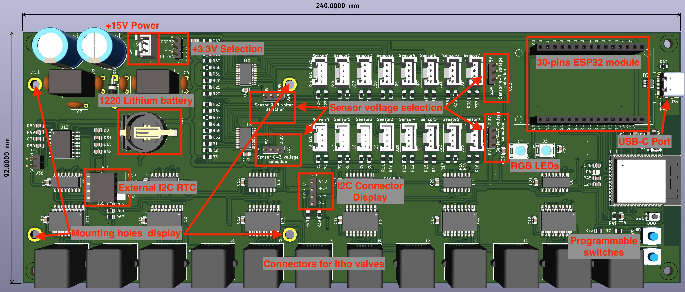

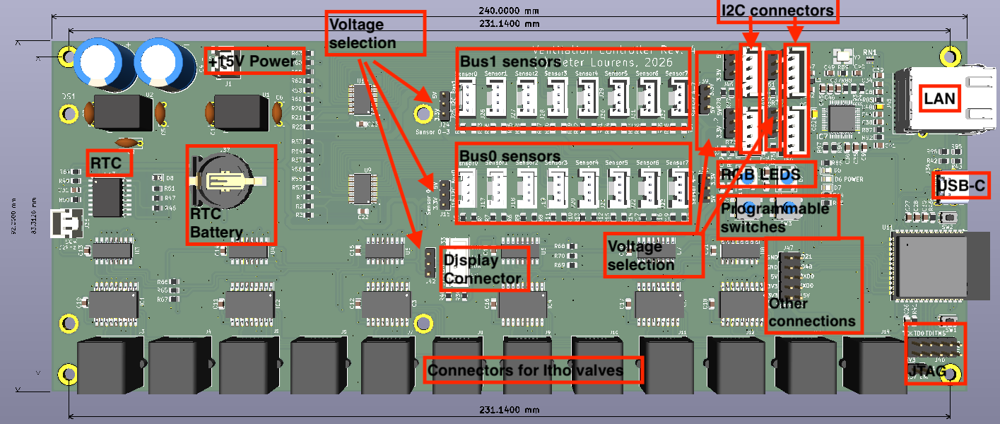

## Software design
The software is written in C with ESP-IDF. Additional libraries are included for the RGB LEDs and littlefs. The software is modular because most functions are written as individual tasks. It should be possible to run the software without WiFi connection but with reduced functionaltiy.

The software has the following tasks:
* task_i2c_ds3231 - Task to regurlarly synchronise the system time with NTP and health diagnostic
* task_i2c_lcd - Task for displaying data on the LCD display
* task_i2c_sensors - Task to regurlary read the sensor values
* task_influxdb - Task to data on regular intervals to InfluxDB. Uses standard HTTP protocol, no additona libraries required
* task_mqtt - Task to publish data to MQTT, uses default MQTT functions available in ESP-IDF
* task_pushbutton - Task to control the functions of the 2 programmable pushbuttons
* task_rgb - Task to control the RGB LEDs
* task_statemachine - Task to control the statemachine. The statemachine decides how the systems responds to events such as events in time or sensor readings
* task_sys_stats - Task

The following external libraries are required (included in managed_components):
* Espressif_led_strip
* joltwallet/littlefs

## Web interface

### Status interface

This is the root page providing an overview of the sensor readings.

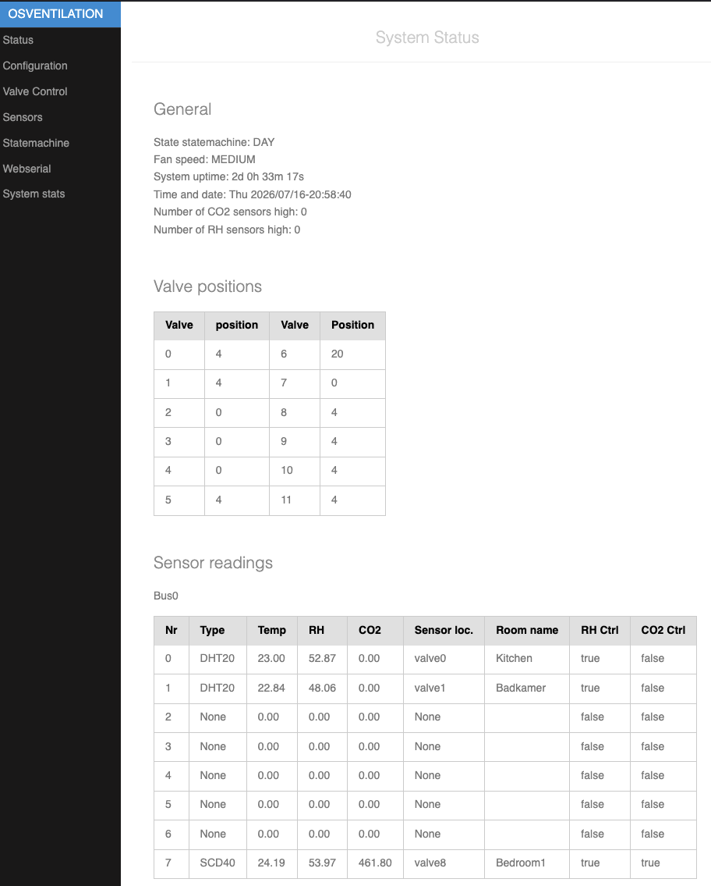
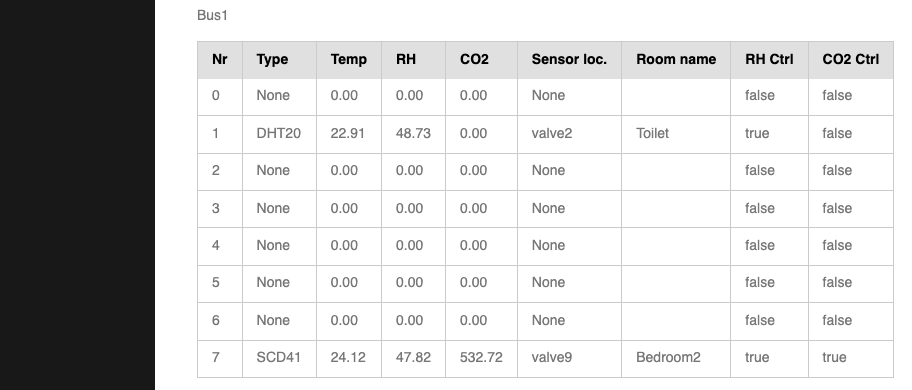

### Settings

Overview of the settings page. Each section of the settings page is detailed below.

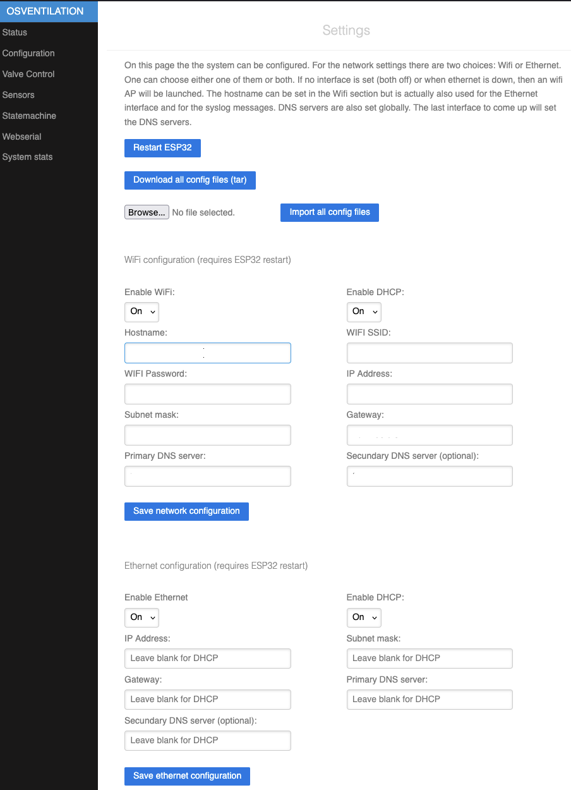

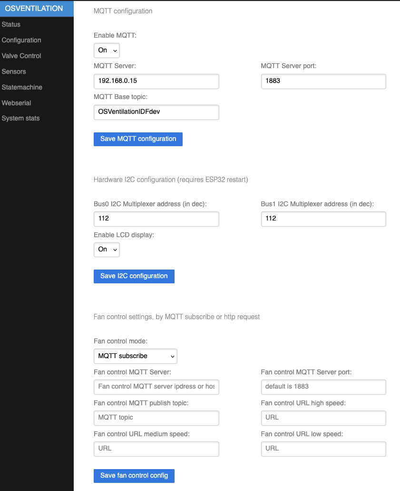

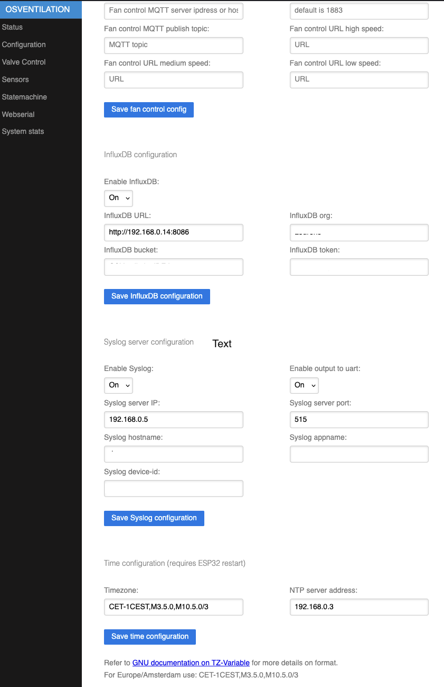

#### Network settings
With empty settings the controller will start as an access point. With a mobile phone or tablet a WIFI connection can be made to "OSVENTILATION-WIFI". Once connected the webinterface can be reached on http://192.168.4.1

To be able to connect the controller to an existing Wifi access point both the SSID and WIFI password must be filled in and the following choice must be made:
* DHCP (default and suitable for most users)
* Manual network configuration

For DHCP mode the dropdown menu must set to "On" (default). If DHCP is set to off then all other field must be filled in order to make a proper manual Wifi connection. If only one DNS server is available then fill the same IP address in for both fields. There is no check on the validity of the filled in data so make sure the data is correct!

Save the settings and reboot the controller with the "Restart ESP32" button.

#### MQTT Settings

Fill in this section to enable and configure MQTT. The default setting is MQTT off with empty settings. The minimum settings are "Enable MQTT" to "On", the MQTT IP address and the base topic <b>(what happens if this is left blank)???</b>. If the MQTT server port is left empty then the default port of 1883 is assumed. 

The settings will become active as soon as the "Save settings" button is pressed. No need to reboot the controller.

#### I2C Settings

In this section the I2C address of both I2C multiplexers are specified. If left empty the default (0x62) is used. If for some reason a different address is chosen by installing resistors R../R../R.. for bus0 or R../R../R.. for bus1 fill in the I2C settings

In these settings the LCD can be enabled and the address can be filled in. If enabled without filling in the I2C address, the default address (0x62) is assumed.

### Valve Control

From this page the valves can be calibrated and controlled. The valves have no means of giving feedback on their position. If the valves are operated beyond their full closed position the connection between the shaft and the rubber will run off the shaft and the valve can't be controlled anymore. If the valve is fully open and operated further open, the device which connects the shaft with the rubber will be pulled out of the rubber and control of the valve is no longer possible. I have not experienced it will damage the valves. The operating range is defined between 0 (fully closed) and 24 (fully open). The valves can only move in steps of 1. This is a design choice and I think there is no necessity for a finer control but it can be done and requires changes to the code.

To keep the valves within their operating range, the position is recorded on the flash storage as a JSON file. The structure is:

{ 
    &nbsp;&nbsp;&nbsp;&nbsp;&nbsp;&nbsp;&nbsp;&nbsp;"valve0":0, 
    &nbsp;&nbsp;&nbsp;&nbsp;&nbsp;&nbsp;&nbsp;&nbsp;... 
    &nbsp;&nbsp;&nbsp;&nbsp;&nbsp;&nbsp;&nbsp;&nbsp;"valve11":0 
}

When the default configuration file is generated all valve position will be zero. If in reality the valve are not in the zero position, one can either remove the rubber and adjust he valves but also this webpage can be used to move the valves to the zero position without storing the positions in the microcontroller. In this way the position of the valves can be calibrated in line with the default file. If, for some reason, the valves need to be moved without losing the calibration, one can als tick the checkbox to store the position in flash. When normal operation then resumes, the valves are also moved back to the position according to the operating mode, see also section "statemachine". This page also has a checkbox to check if the valve operates within in limits when manually moved. The valve will still move but not beyond their limits.

See also commissioning section. When the controller is delivered there is no configuration file yet for the valves. With the button on the page this config file can be created. The settings 

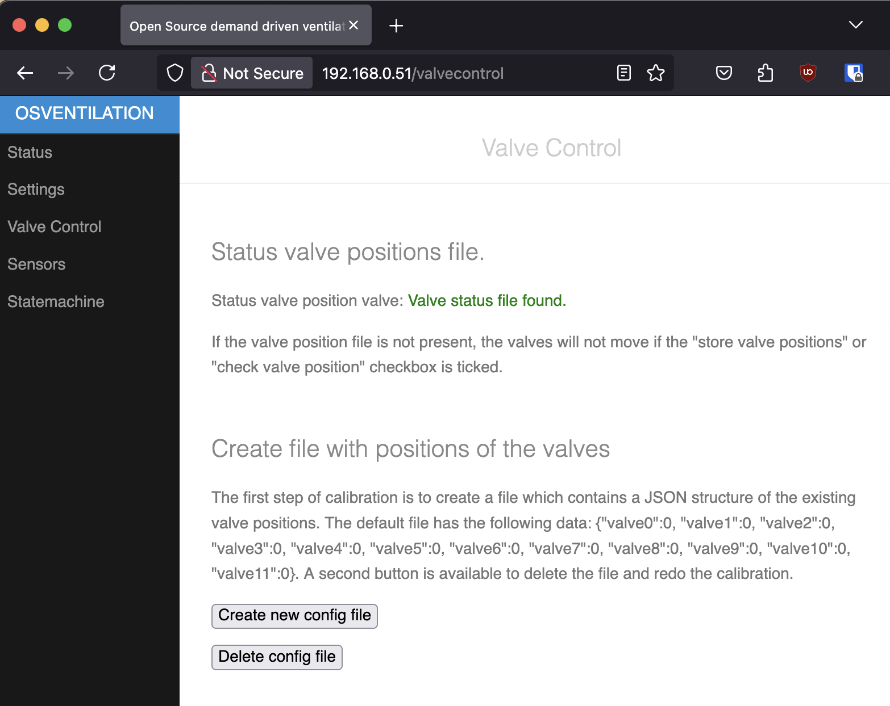
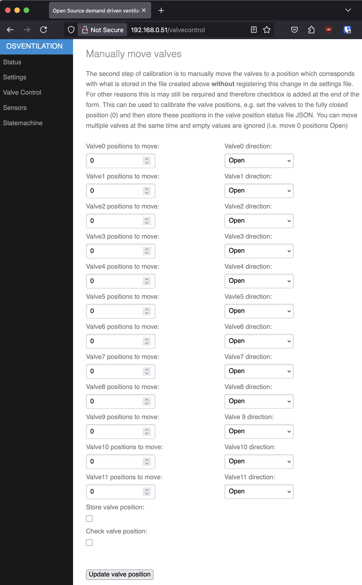

### Sensors

Sensor settings.

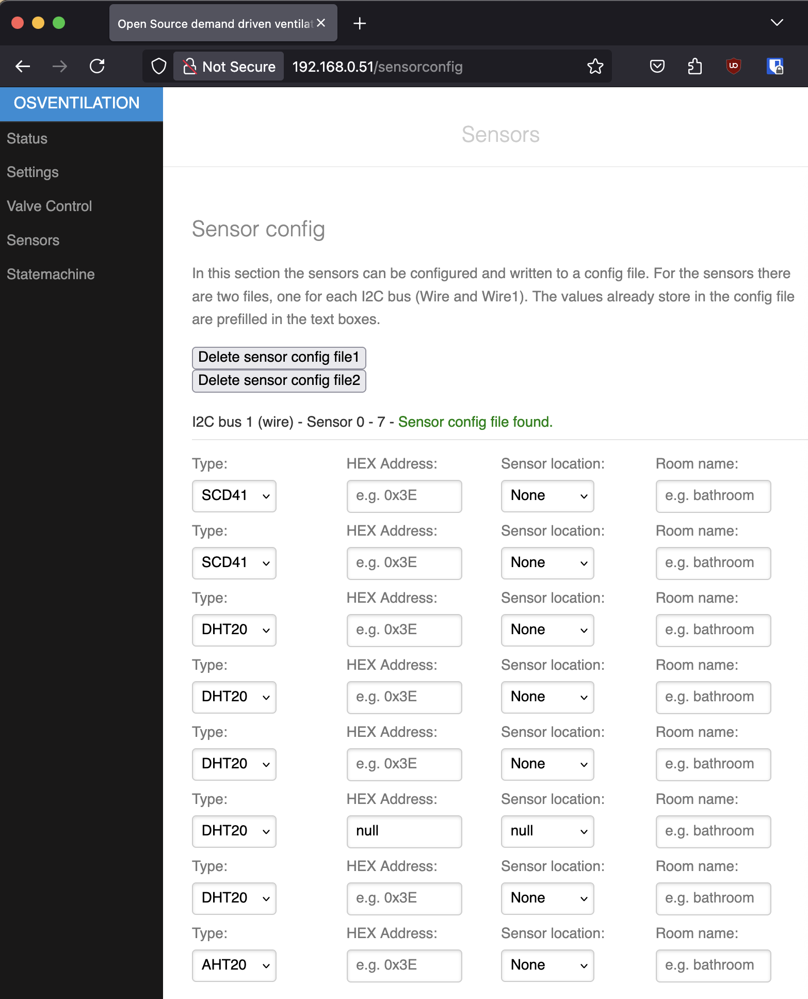
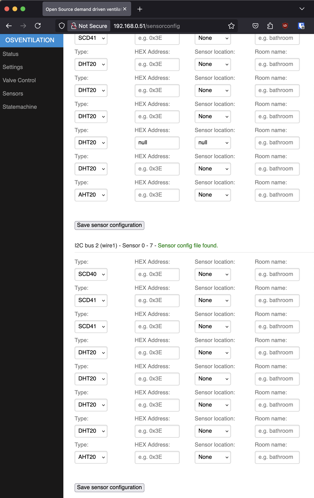

### Statemachine

Settings for the statemachine.

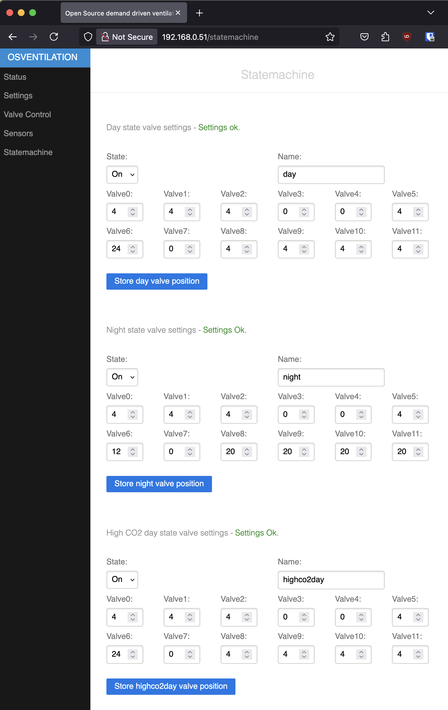
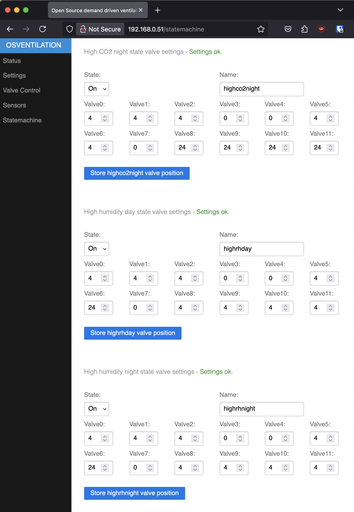

## InfluxDB Data Structure

In the settings file the bucket can be configure. In this bucket the following structure will be used:

Measurement and fields:
* Sensors
    * temperature
        * bus0
            * Sensor0
            * ...
            * Sensor7
        * bus1
            * Sensor0
            * ...
            * Sensor7
    * humidity
        * bus0
            * Sensor0
            * ...
            * Sensor7
        * bus1
            * Sensor0
            * ...
            * Sensor7
    * CO2
        * bus0
            * Sensor0
            * ...
            * Sensor7
        * bus1
            * Sensor0
            * ...
            * Sensor7
* Sesnosrs_avg
    * Same stucture as instantenious sensor readings
* Status
    * fanspeed
    * state
* System
    * Uptime
* position
    * valve0
    * ...
    * valve11

## Comissioning and initial startup
The controller will be delivered with the latest software installed. To update the software you can clone the github repo, compile the softwares (use vscode with platformIO), build and flash the filesystem image and then upload the compiled firmware. 

### Step 1 - Configure WIFI
The controller will not come with WIFI credentials and therefore start as access point. Connect to this access point, SSID is OSVentilation and a password is not required. Go to the "Settings" page and fill in the SSID and password of you WIFI access point. Push the "ESP restart" button on the same page to reboot the controller.

### Step 2 - Configure I2C
Go the the settings page to the I2C configuration. The default I2C multiplexer is set to 112. If no changes are made to the resistors to set a different address no changes are required.

### Step 3 - Configure sensors
Go to the "Sensors" page and configure the sensors. The sensors page has for each sensor connected to bus 0 or bus 1 5 possible settings. Set the type of sensor, e.g. DHT20, the Sensor Location (at which valve is the sensor installed), the Room name (logical description of which room the sensor is measuring) and RH on on or off and CO2 on or off. The On/Off settings configure is a sensor participates in the statemachine to detect high RH or hih CO2. Go back to the home page to check if sensors are read properly.

Note that is with the Sensor Location setting ther is the options to set a sensor at the Fan inlet. This sensor measures the overall CO2/RH levels and if only this sensor is installed there is no individual control of valves per room. Ideally every bedroom has an CO2 sensor while every "wet" room such as bathroom or kitchen has an sensor which can measure at least RH.

### Step 4 - Fan control
The fan is not controlled directly by the controller. In case of an Itho fan, external control is only with the Itho remote control. To get control over de fan an additional PCB is required, the "Itho CVE WiFi add-on" which can be bought here: https://www.nrgwatch.nl/ Other brands of fans may have a different way of setting the fan speed.

The controller offer two methods of controlling the speed (based on usage of "Itho CVE WiFi add-on"):
* HTTP API version 1
* MQTT Publish

Select in the dropdown button either the HTTP API option or the MQTT option. Fill in the other field to complete the configuration and save the configuration. If his section is not configured, the controller will work but with limited functionalty as adjusting the fan speed is required to control for example the CO2 levels or high RH levels.

### Step 5 - Enable display (Optional)
Set enable display to "On" if the unit is supplied with an display or if you have added a display later on. Note that the software assumes a 4x20 LCD display and the display address is fixed in the software. Differnt display may work but software changes may be required.

### Step 6 - Configure MQTT (Optional)
By default MQTT is not enabled. To enable MQTT, got to the settings page and set Enable MQQT to On, fill in the MQTT server IP address, MQTT server port (default 1883) and set the MQTT base topic. Save the settings

### Step 7 - Configure InfluxDB (Optional)
By default writing measurments to InfluxDB is not enabled. Writing to InfluxDB can be configured in the settings page. Fill in also 

